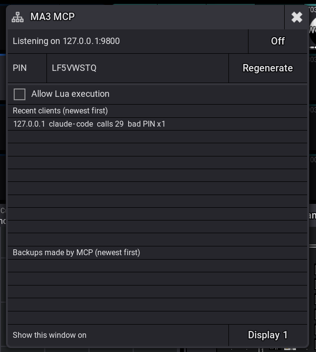

# MA3 MCP

**Alpha.** Working on a grandMA3 light and onPC 2.5.1.1; see CHANGELOG.md for what is not yet verified.

A grandMA3 Lua plugin that turns the console into an MCP server, so an AI model on the production network can read the whole showfile and run console commands.



## Features

- The console is the server: one plugin, HTTP on the console's production-network address, nothing to install or keep running anywhere else.
- Full read access to the showfile: any object by address, its properties, its children, a text dump.
- Fast bulk reads for housekeeping: the patch as a tree with every multi-instance fixture's instances, groups with their members, sequences with cue counts and every page/executor they sit on, pages with executor assignments, presets, macros.
- Writes through the console's own command line (`ma3_command`, or a whole list per request with `ma3_commands`) and property sets (`ma3_set`), with undo groups so one Oops reverts a whole job.
- Deep reads: `ma3_cue_timing` (fades and delays per cue), `ma3_timecode` (tracks and events), `ma3_history` (last command and response, undo list), `ma3_export` (an object's XML, the only way to see the values inside cues). Bulk reads take filters (`from`/`to`/`name` on sequences, `page` on pages, `summary` on fixtures).
- Backup save before destructive jobs, plain save, and arbitrary Lua behind an operator-only switch.
- A window on the console: On/Off, the PIN, Regenerate, Allow Lua, the last ten clients (bad PINs included), the last five backups, display picker.
- PIN authentication on every request, lockout after five bad PINs, refuses the one call known to hang grandMA3 2.5.1.
- Speaks both the 2026-07-28 stateless MCP flow and the older `initialize` flow; verified with Claude Code 2.1.295.

## Requirements

- grandMA3 light (or any grandMA3 console / onPC) on software 2.5.1.x. The plugin was built and live-tested on onPC 2.5.1.1 (macOS); the console runs the same software.
- A client on the same production network that speaks MCP over HTTP (Claude Code, or any MCP client library).
- For development: macOS with Homebrew `lua` (5.5) or `lua@5.4`, LuaRocks with `luasocket`, and grandMA3 onPC.

## Installation

See [docs/INSTALL-CONSOLE.md](docs/INSTALL-CONSOLE.md). In short: copy `MA3 MCP.lua` and `MA3 MCP.xml` from the release zip to a USB stick at `grandMA3/gma3_library/datapools/plugins/`, then on the console:

```
Import Plugin Library "MA3 MCP.xml" At Plugin 91
Plugin "MA3 MCP"
```

Save the show. The plugin ships off; start it with one tap after each show load.

## Usage / Quick start

1. Start the plugin; read the PIN from its window.
2. On your machine:

   ```
   claude mcp add --transport http ma3 http://<console-ip>:9800/mcp --header "Authorization: Bearer <PIN>" --scope user
   ```

3. In Claude Code, ask for `ma3_status`. Then give it a job: "list the sequences that are on page 6", "build groups for the new Portman instances", "remove the old song sequences and add the ones in this list".
4. For jobs that change the show, the `ma3-housekeeping` skill in this repo (`.claude/skills/`) makes the model read `docs/CONVENTIONS.md`, show its plan, wait for a go, back the show up, run the commands in one undo group, and re-read to verify.

## Configuration

- Window: On/Off, Regenerate PIN, Allow Lua execution (off at every start), display picker.
- Command line: `Plugin "MA3 MCP" "off" | "status" | "pin" | "lua on" | "lua off" | "regen" | "bind <ip>" | "bind auto" | "<port>"`.
- Settings file on the console: `gma3_library/ma3_mcp_settings.json` (`pin`, `port`, `bind` override, `display`, `backups`, `clients`).
- `docs/CONVENTIONS.md`: how the show is organized, read by models before a job.

## Building from source

```
git clone https://github.com/upipibi/MA3-MCP.git
cd MA3-MCP
brew install lua lua@5.4 luarocks && luarocks install luasocket && luarocks --lua-version=5.4 install luasocket
make test            # unit tests on Lua 5.5 (the console's version); make test LUAV=5.4 for 5.4
make build           # dist/MA3 MCP.lua + dist/MA3 MCP.xml
make install-onpc    # copies into the local grandMA3 onPC 2.5.1 library and plugin folders
make release         # dist/avl-ma3-mcp-<version>.zip
```

## Project structure

```
src/                 plugin modules (bundled into one file by tools/bundle.lua)
  http.lua           HTTP/1.1 request parser and response builder
  server.lua         non-blocking socket server, one pass per step()
  mcp.lua            MCP JSON-RPC dispatcher (2026-07-28 and legacy flows)
  auth.lua           PIN, lockout, recent clients
  settings.lua       settings file (deterministic JSON)
  console.lua        thin wrapper over the grandMA3 Lua API
  addr.lua           address validator ([unsafe-range])
  tools/             generic, bulk, deep (cue timing, timecode, history, export), show (backup/save), lua_exec
  ui.lua             the window
  main.lua           plugin entry, lifecycle, command arguments
plugin/MA3 MCP.xml   plugin descriptor
tools/bundle.lua     builds dist/MA3 MCP.lua
tools/mcp_call.py    call one tool on the console's server from a shell (URL and PIN from Claude Code's config)
tools/show_digest.py bulk-read dumps of a show -> one Markdown report
tools/cue_timing.py, cue_values.py   cue fade table / per-cue values from a dump or an export
test/                plain-Lua test runner, fakes (console, socket, fs, display), tests
spike/               throwaway console probes (gate zero, onPC facts)
docs/                design, plan, research facts, conventions, programming style, install guide, job records (docs/jobs/)
.claude/skills/      the ma3-housekeeping skill
```

## Security

See [SECURITY.md](SECURITY.md). Plain HTTP with a bearer PIN on the production VLAN; the console's Lua has no TLS.

## Troubleshooting

| Symptom | Check |
| --- | --- |
| Nothing listens after `Plugin "MA3 MCP"` | `ma3_mcp_load.txt` in the console temp folder (`FAILED:` names the error), then `ma3_mcp.log` |
| `401` | wrong or missing PIN; the window lists bad-PIN attempts |
| `429`, or "Needs Auth" in an editor's MCP panel | five wrong PINs in a minute lock that machine out for five minutes. Do not use an Authenticate button (the plugin has no sign-in page; each try counts as a wrong PIN). Fix the saved PIN, wait, reconnect once |
| `429` | five bad PINs in a minute from that address; wait five minutes |
| A tool call times out | a dialog may be open on the console (the window shows STALLED); dismiss it, re-read state before resending |
| Typed commands do nothing after using the window | tap the command line first |

## License

[MIT](LICENSE).

## Credits

See [CREDITS.md](CREDITS.md).
